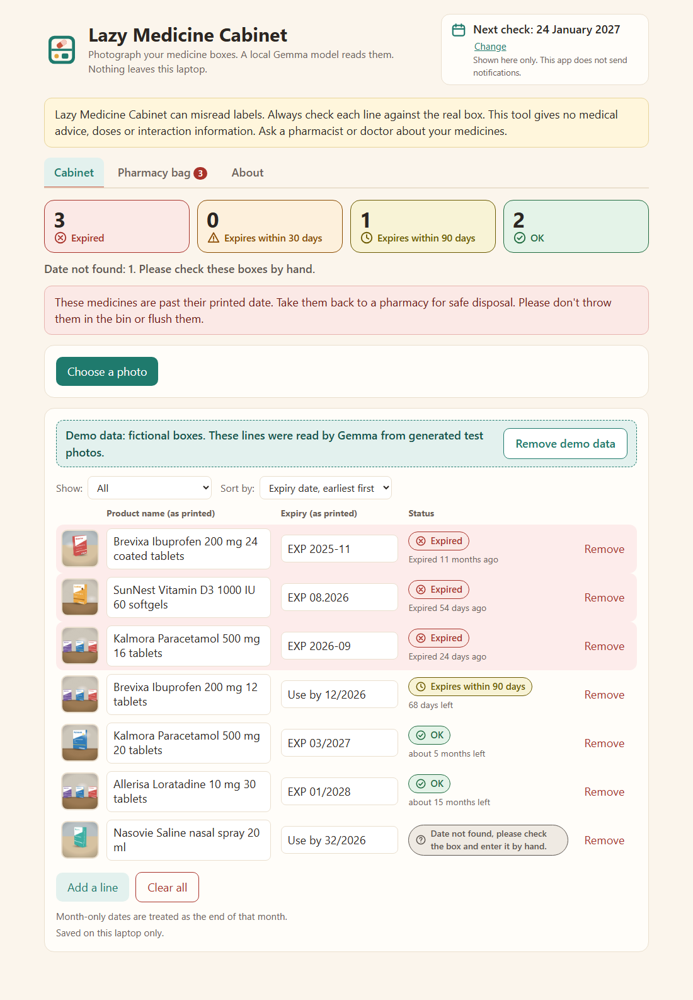
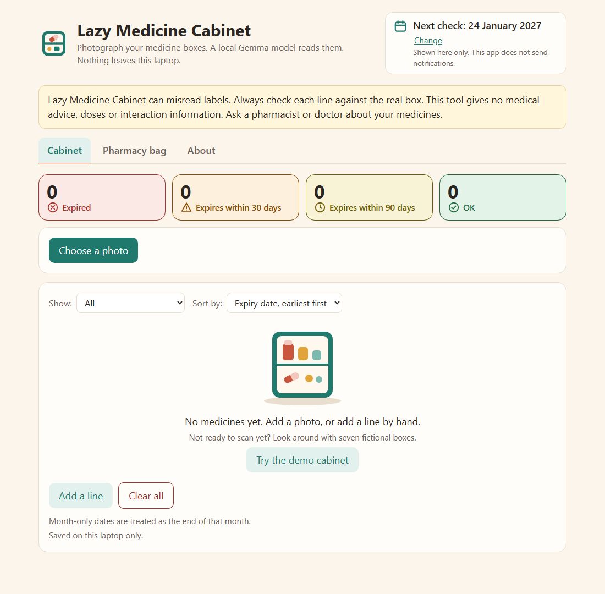
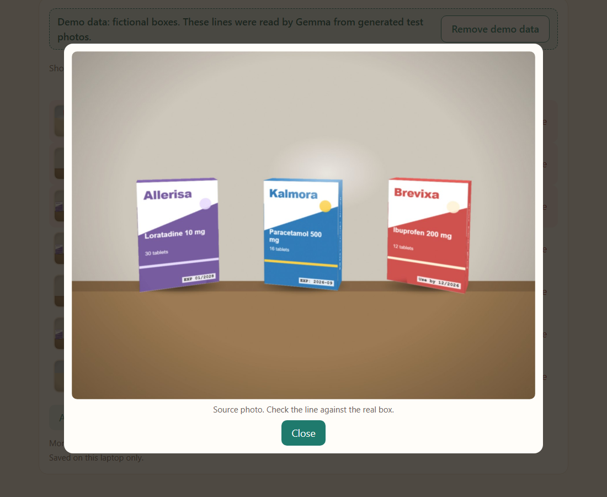
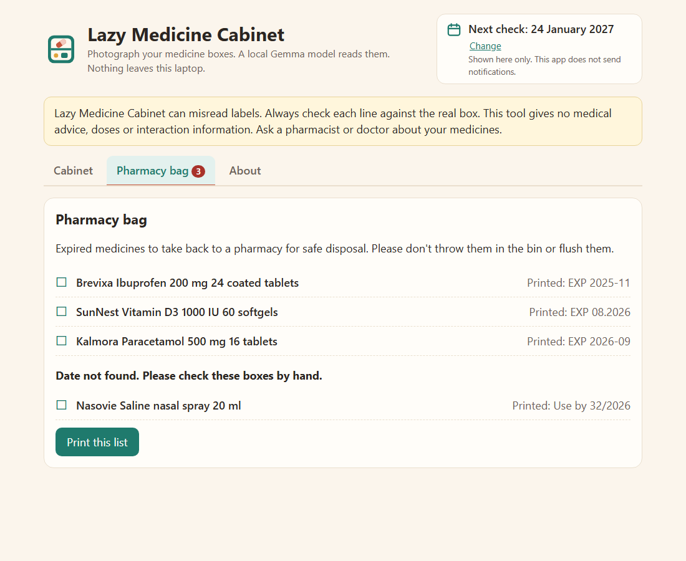
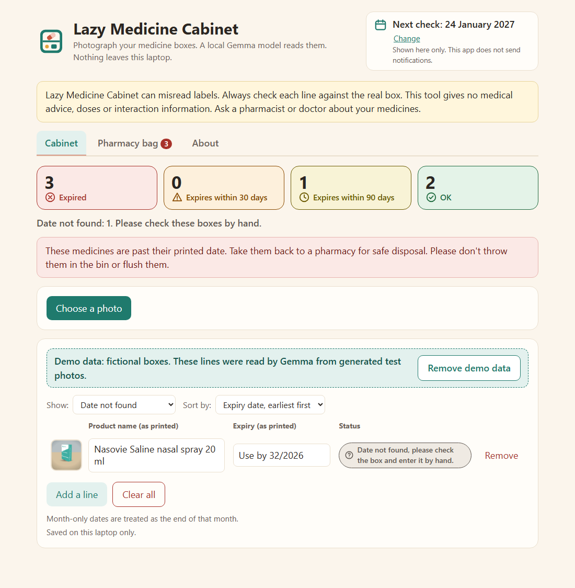
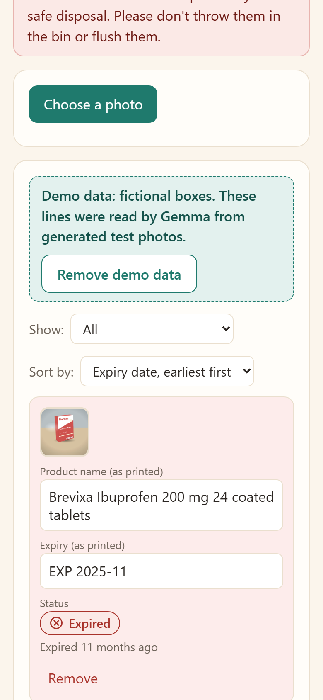

# Lazy Medicine Cabinet

Take a photo of your medicine boxes. A **Gemma 3 vision model running locally on your laptop** (through [Ollama](https://ollama.com)) reads the boxes and builds a small inventory: product name as printed, expiry date, and a status (expired, expires within 30 days, expires within 90 days, OK). You can correct any line by hand. Expired items get a reminder to take them back to a pharmacy.

**Nothing leaves your laptop.** No cloud APIs, no telemetry, no external fonts or scripts. The web server listens on `127.0.0.1` only, and its only outgoing connection is to Ollama on the same machine. The photos you scan stay only on your laptop, in `data/photos/`, so you can see where each line came from. They are deleted when the line is removed, or with "Clear all".

> **Important.** Lazy Medicine Cabinet can misread labels. Always check each line against the real box. This tool gives no medical advice, doses or interaction information. Ask a pharmacist or doctor about your medicines.

Built for the DEV Hacktoberfest Open-Source AI Challenge (week 3, "Slow and Steady"), Gemma category: the model runs locally.



## What's in the app

- **Cabinet:** summary cards (Expired, Expires within 30 days, Expires within 90 days, OK; click one to filter), a filter and a sort by expiry date or name, and every line editable by hand. Each line shows the time left under its status ("68 days left", "Expires in 12 days", "Expired 2 months ago"), a light red background when expired and light amber within 30 days, and a small thumbnail of the photo it was read from (click it to see the photo larger). Long product names wrap instead of being cut off. Your list is saved on your disk and is still there next session. "Clear all" asks first.
- **Demo cabinet:** on the empty screen, "Try the demo cabinet" loads 7 fictional boxes with the results Gemma actually produced for the generated test photos, clearly labelled "Demo data: fictional boxes". "Remove demo data" takes only those lines away and leaves your own.
- **Pharmacy bag:** the expired items to take back to a pharmacy for safe disposal, plus the lines whose date could not be read ("check these boxes by hand"). "Print this list" prints only that list.
- **Next check:** a date shown on top, three months ahead by default, that you can change. It is only a date on the screen: the app sends no notifications.
- **About:** what it does, the privacy promise, how it works and the limits.
- It works on a phone-sized screen too, and every status has an icon and a text label, never colour alone.

The empty screen offers the demo cabinet:



Click a thumbnail to see the photo a line was read from:





When the model cannot read a date properly (here it returned `Use by 32/2026`), the app does not guess. It asks you to check the box:



On a phone-sized screen the lines stack as cards:



## How it works

1. The browser shrinks your photo (longest side 1024 px) and sends it to the local server. If the photo produced lines, the server keeps that copy in `data/photos/` for the thumbnails; it is deleted together with its last line.
2. The server asks `gemma3:4b` (via `http://127.0.0.1:11434`) to copy the name and the expiry text **exactly as printed**. The prompt forbids describing uses, doses or advice.
3. The app parses the printed date and computes the status **in code**, not with the model.
4. You review and fix any line. Your list and the next-check date are saved in `data/cabinet.json` on your disk (a file from the first version, a bare list, is migrated automatically).

Month-only dates are treated as the end of that month (`EXP 03/2027` is valid through 2027-03-31). Dates are read day-first (`31/10/2026`) or ISO (`2026-10-31`). A date the app cannot parse is shown as "Date not found, please check the box and enter it by hand."

## Run it

You need Node 20+, [Ollama](https://ollama.com/download), and about 5 GB of free RAM.

```bash
ollama pull gemma3:4b      # about 3.3 GB, one time
npm install                # only needed for the browser test
npm start                  # http://localhost:3977
```

Set `LMC_MODEL` to use another vision model (for example `gemma3n:e2b`) and `PORT` to change the port.

**Speed.** On the development laptop (Intel Core i3-1005G1, 2 cores, 7.8 GB RAM, no GPU) one photo takes **about 60 to 85 seconds**. A GPU makes this much faster. The app shows a progress message and handles one photo at a time.

## How well does it read? (honest numbers)

There are no real-world medicine photos in this repository. The test photos in [`samples/generated/`](samples/generated) are **generated pictures of fictional boxes** (invented brands, no real logos or packaging), rendered with CSS 3D and Playwright with angle, blur, glare and noise: [`tools/make-samples.mjs`](tools/make-samples.mjs). They are easier than many real boxes (clean fonts, no curved or shiny blister foil), so treat the numbers as a floor for "does the pipeline work", not as a promise for your cabinet. The ground truth is in `truth.json`; scores come from [`tools/score.mjs`](tools/score.mjs) and the raw model outputs are committed too.

7 boxes in 5 photos (one photo has the date printed small on the side, one has three boxes):

| | Prompt v1 | Prompt v2 (current) |
|---|---|---|
| Full name read (brand + medicine + strength) | 2 / 7 | **7 / 7** |
| Date value correct | 6 / 7 | 6 / 7 |
| Status correct | 6 / 7 | 6 / 7 |
| Time for 5 photos | 344 s | 344 s |

Dates did **not** improve with the better prompt. Different boxes failed in each run: v1 misread `Use by 12/2026` as `Use by 32/2026` on one box of the three-box photo (and read the small side date correctly), while v2 read that box correctly but misread the small side date `12/2026` as `32/2026`. In both cases the app showed "Date not found" instead of a wrong status. Other quirks: the model sometimes replaces "Use by" with "EXP", and v2 adds the pack size ("20 tablets") to the name. This is one run per prompt on one machine, a small sample: expect misreads, and always check the box.

## Tests

```bash
npm test
```

- unit tests for date parsing and status boundaries (month-only dates, leap years, impossible dates),
- unit tests for parsing the model's output (code fences, junk, duplicates) with a mocked Ollama,
- unit tests for the inventory views (counts, filter, sort, pharmacy bag, next-check date maths, migration of old data),
- Playwright end-to-end tests of the real app with a stand-in for Ollama (needs `npx playwright install chromium` once): scan, summary cards, time left and row colours, filter and sort, thumbnails and the photo viewer, pharmacy bag, next check, saved data, "Clear all", photo files deleted with their last line, the demo cabinet, long names that must stay readable (desktop and phone), a phone-sized layout with no sideways scrolling, photo URLs that only serve our own files, and a check that no request leaves localhost. 26 tests in total.

To re-run the model on the sample photos: `node tools/run-samples.mjs generated`, then `node tools/score.mjs results-v2-prompt.json` (needs Ollama and ffmpeg; set `LMC_RESULTS=name.json` to choose the output file).

## Privacy and safety

- No cloud services, accounts, analytics or telemetry. Requests with a non-localhost `Host` header are refused.
- Your list and the photos you scan live in `data/` on your computer (git-ignored, never uploaded). Removing a line deletes its photo once no other line uses it, and "Clear all" deletes all of them. Your own test photos can go in `samples/` (also git-ignored).
- The app never gives medical advice, doses or interactions, and it says so on screen. Take expired medicines back to a pharmacy for safe disposal; don't bin or flush them.

## License

MIT, see [LICENSE](LICENSE).
